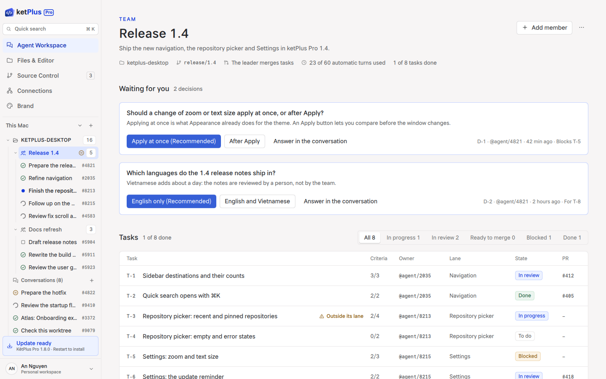

# KetPlus

<p align="center">
  <picture>
    <source media="(prefers-color-scheme: dark)" srcset="assets/brand/ketplus-pro-lockup-dark.png">
    
  </picture>
</p>

KetPlus is an early-stage, fast, lightweight, cross-platform text editor for
Windows, macOS, and Linux. One source tree builds two editions:

| Edition | Product | Contents |
| --- | --- | --- |
| `lite` | **KétPlus** | The editor: workspace, Git, terminal and document preview |
| `pro` | **KétPlus Pro** | The editor plus Agent Workspace, Atlas, the local daemon and remote sessions |

Both editions are open source under MPL 2.0. The KétPlus mobile apps and the
hosted relay, gateway and account services are separate proprietary products.

<p align="center">
  
</p>

A team in KétPlus Pro: a leader plans the tasks, developers work on them and a
reviewer checks each one, while decisions wait for the user. The picture is the
design mock in [`mockups/qt`](mockups/qt/README.md) with fixture data.

The first milestone deliberately stays small: reliable file editing, tabs,
UTF-8, syntax lexing, and a native desktop experience. Optional Atlas tabs use
the platform WebView (WebKit on macOS).

## Stack

- C++20
- Qt 6 Widgets
- Scintilla editing engine
- Lexilla syntax lexers
- CMake

The shared editor lives in `core/`. Its build fetches the pinned Scintilla,
Lexilla, libvterm, KetQt and KÉT Sans revisions.

## Prerequisites

- CMake 3.24+
- Ninja
- Qt 6.11+ with `Core5Compat`, `Svg`, `SvgWidgets`, `Concurrent`, and `WebView`
- A C++20 compiler
- Optional `sccache` or `ccache` for persistent compiler-object caching

On macOS with Homebrew:

```sh
brew install cmake ninja qt qt5compat sccache
export QT_ROOT="$(brew --prefix qt)"
```

## Build and test

```sh
cmake --preset dev            # KétPlus Pro (macOS)
cmake --build --preset dev
ctest --preset dev

cmake --preset lite-dev       # KétPlus, the editor alone (every platform)
cmake --build --preset lite-dev
ctest --preset lite-dev
```

`KETPLUS_EDITION` selects the edition. It defaults to `pro` on macOS and to
`lite` elsewhere, where Pro is not built yet.

Build work is cached in stages locally and in CI:

1. Qt SDK: managed by the local package manager and cached by the CI Qt action.
2. Source dependencies: shared across build presets in `.cache/fetchcontent`.
3. Compiler objects: CMake automatically selects `sccache`, then `ccache`, when available.
4. Generated and linked outputs: retained per preset under `build/`.

Both cache directories are disposable. Remove the affected directory when an
explicit cold build is required; normal builds should keep them between runs.

Run the development build:

```sh
open build/dev/KetPlus.app         # macOS
./build/dev/KetPlus                # Linux
build\\dev\\KetPlus.exe          # Windows
```

Mermaid blocks in Markdown preview and assistant chat messages are optional. To enable them, install the
official Mermaid CLI and restart KetPlus (or edit the document again):

```sh
npm install -g @mermaid-js/mermaid-cli
```

KetPlus also checks `KETPLUS_MMDC` when a custom `mmdc` executable path is needed.
Chat renders completed Mermaid fences asynchronously using the same cached
renderer, retaining SVG output so large diagrams stay sharp while zooming.
Click a diagram to open the zoom/pan viewer. Incomplete fences and
render failures retain their source; conversation copy always keeps the original
Markdown, including Mermaid code.
When `mmdc` is missing, each Mermaid block shows
`npm install -g @mermaid-js/mermaid-cli` with a play button. Installation runs
only on click, without sudo; successful installation retries rendering, while
errors remain visible with a retry action. Node.js/npm must already be installed.

## Atlas tabs and code index

Install Node.js 22+ and the KetAtlas CLI (`npm install -g ketatlas@0.5.0`).
Place each project at `<name>.ketatlas/atlas.json`. Use **File > New Atlas Tab** to open a searchable atlas grid. Each selection
opens in its own tab; the plus button or New Tab while viewing an atlas opens
another grid. Reopening an atlas switches to its existing tab.
The picker also provides **Add Atlas**. It replaces that picker with an Atlas
Builder: describe the desired experience in the compact agent chat while the
preview explains Atlas concepts. The backend adds the KetAtlas bundle contract
to the prompt automatically, so the user does not need to specify filenames or
manifest details. When the index discovers new valid bundles, the first one by
relative path opens in the same tab and the chat becomes a collapsible panel
floating over the preview. Builder conversations remain available in Agent
Workspace with an `Atlas:` title. Only one unfinished builder is kept per
worktree; choosing **Add Atlas** again returns to it.
JSON in `test`, `tests`, `fixtures`, or `__fixtures__` directories and
`baseline-*` JSON files remain indexed but are omitted from the atlas picker.

The background Atlas index covers only the active workspace/worktree. Switching
worktrees replaces the indexed root; inactive and linked worktrees are not
scanned. Git workspaces use an exact `**/*.ketatlas/atlas.json` pathspec and
respect ignore rules; non-Git workspaces walk directories but inspect only the
same bundle pattern. That walk skips hidden folders and `~/Library` and stops after
10,000 folders or 2 s. Unchanged manifest results, including non-Atlas results,
are cached. Filesystem events, workspace saves, opening the picker, and
Spotlight trigger a debounced refresh. Unchanged snapshots do not redraw the
Atlas UI.

Spotlight searches files and Atlases in the active worktree; repositories and
worktrees are reached from the sidebar. **Go to File** (`Ctrl+P`) opens it.
File results combine open tabs with a path-only list of workspace files. The
list is collected on a background thread when Spotlight opens and reused for
30 seconds. It skips hidden, dependency and build folders and stops at 50,000
files. File contents are never indexed and no file watcher runs.

The editor follows KetPlus CM 0.2.0: line, selection, comment and case commands;
multi-cursor editing; view options such as wrap, whitespace, guides, ruler,
folding and zoom; bookmarks and go to line or symbol; a command palette
(`Ctrl+Shift+P`) built from the menu bar; back/forward caret history; split
view; full screen and distraction-free mode; **Search in Files** from the
activity bar; and status bar controls for encoding, line endings and language.

An atlas tab inactive for five minutes releases its WebView and local server,
but keeps its tab, atlas path, flow, selection and zoom for reopening. An open
progress editor delays suspension to avoid losing an unsaved draft. Closing a
tab stops its owned process. `KETPLUS_KETATLAS_CLI` overrides CLI discovery; the
missing-CLI view shows the pinned npm command, offers an explicit **Install
KetAtlas** action, and provides an executable picker. Installation runs only
after the user clicks the action, never automatically when opening a tab. A
missing npm executable produces Node.js 22+ guidance, while install output stays
visible on failure and a successful install retries the preview.

On macOS, Atlas uses the system WebKit through Qt WebView. The Qt 6.11 C++ API
is a Technology Preview. Windows uses an available WebView backend; Linux needs
Qt WebEngine as the Qt WebView backend. Native macOS rendering and suspension
can be checked with `KETPLUS_NATIVE_ATLAS_TEST=1 build/dev/ketplus_atlas_tests nativeAtlasSmoke`.

## Current capabilities

- Create, open, edit, and atomically save files
- Multiple movable and closable tabs
- Undo, redo, cut, copy, paste, delete, and select all
- Find and replace with next/previous, case, whole-word, and replace-all modes
- Keyboard navigation between tabs
- Unsaved-change protection
- UTF-8 editing
- Scintilla-based editor surface
- Generic syntax highlighting for unknown source files (comments, strings, numbers, and common keywords)
- Language-aware highlighting for C/C++, JavaScript/TypeScript, Python, HTML/XML/PHP,
  CSS, JSON, Markdown, shell, YAML/TOML, SQL, Rust, Java, C#, Go, Swift, Kotlin,
  Ruby, Lua, Dart, Zig, CMake, Makefiles, Dockerfiles, properties, and diffs
- Live native Markdown preview with optional Mermaid diagrams rendered by `mmdc`
- Lazy workspace Explorer and a background Atlas bundle index
- Single-click file opening plus create, rename, reveal, and move-to-Trash actions
- Read-only Git status with separate staged/working-tree lists and scoped diffs,
  powered by the installed Git CLI
- Styled inline Git diff tabs with line gutters and semantic added/removed colors
- Fast switching between linked Git worktrees without changing branches in place
- Lazy embedded terminal backed by a real PTY and libvterm on macOS and Linux;
  hiding the panel keeps the shell session alive
- KetJS-inspired compact visual system with matching semantic color tokens
- System, light, and dark appearance modes under `View > Appearance`
- Persistent editor font, font-size, and line-height settings under `Settings…`
  (`Ctrl/Cmd+,`)
- Open files passed on the command line
- Open workspace folders from the command line or with `Ctrl/Cmd+K, Ctrl/Cmd+O`
- Open or focus the embedded terminal with Ctrl/Cmd+Backtick and
  Ctrl/Cmd+Shift+Backtick

See [docs/architecture.md](docs/architecture.md) for project boundaries and the
next milestones. See [docs/design-system.md](docs/design-system.md) for the
desktop adaptation of the KetJS visual language.
The cross-product boundary, identity model, daemon, gateway, and monetization
model are recorded in
[docs/product-architecture.md](docs/product-architecture.md).

Contributors and coding agents should start with [AGENTS.md](AGENTS.md). The
current implementation status, development workflow, test matrix, repository
boundary, CM release procedure, and planned daemon are documented in
[docs/project-status.md](docs/project-status.md),
[docs/development.md](docs/development.md), [docs/testing.md](docs/testing.md),
[docs/repository-boundaries.md](docs/repository-boundaries.md),
[docs/release-process.md](docs/release-process.md), and
[docs/daemon-architecture.md](docs/daemon-architecture.md).

Performance baselines and the repeatable Release-mode benchmark suite live in
[benchmarks](benchmarks/README.md).

## Repository layout

```text
core/               editor, workspace, Git, terminal, preview (both editions; Lite app)
apps/desktop/       KétPlus Pro desktop shell and executable
apps/daemon/        local and headless Linux daemon, ketplusctl
apps/browser/       bundled browser runtime for agent tools
apps/computer/      KetPlus Computer, the macOS computer-use helper app (Swift)
modules/ai/         Agent Workspace and provider transports
modules/atlas/      Atlas integration and code index
modules/remote/     daemon client and relay (Control v2) client
modules/computer/   computer use settings and provider MCP launch
tests/              Pro and cross-boundary integration tests
```

## License

KetPlus is licensed under the [Mozilla Public License 2.0](LICENSE).
Third-party components retain their respective licenses, and the KÉT Sans font
is fetched from its official release at build time under its own license. See
[docs/licensing.md](docs/licensing.md) and
[THIRD_PARTY_NOTICES.md](THIRD_PARTY_NOTICES.md).

The ketPlus and ketPlus Pro names, the ketPlus mark and its lockups are trademarks,
all rights reserved; the MPL grants no licence to them. See [TRADEMARKS.md](TRADEMARKS.md).
