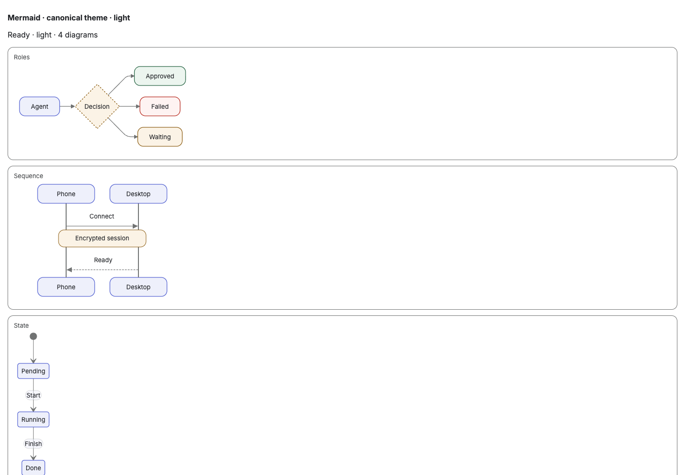
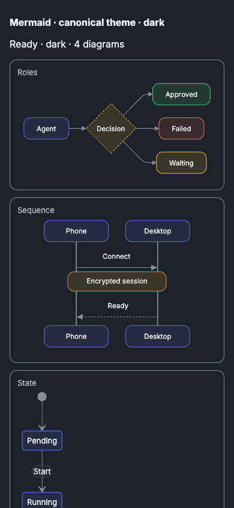

# Mermaid theme alignment

The light/dark configuration snapshots come from the public Két Design System
0.1.44 `runtime/mermaid-theme.js` and its resolved token palette at upstream
revision `e8adee2da3bf` (ketviet PR #2177, Két Blue). Full revision and source
hashes live in `resources/mermaid/SOURCE.json`; the publisher's MIT license is
bundled there. The iOS companion consumes byte-identical snapshots.

To refresh them, load the pinned `foundations/tokens.css` in Chromium, run
`createMermaidTheme(readMermaidPalette(element))` on a `data-kv-design-system`
element with `data-theme="light"` and then `"dark"`, and write each result as
`JSON.stringify(config, null, 2)` plus a newline. Re-running this on the
previous revision `4a5f82df06d5` reproduced the 0.1.41 snapshots byte for byte.

Snapshots retain the upstream configuration: KÉT Sans (then Inter) 13px, 12px
node corners, rounded connectors, compact flow/sequence geometry and semantic
accent, positive, warning, danger and decision classes. Qt adds explicit
state-label fills and converts SVG rectangle radii to attributes while
preserving pills. The v8 cache namespace prevents reuse of earlier themed
diagrams.

## Verification

Két Blue update (0.1.44, `e8adee2d`):

- Regenerating 0.1.41 from `4a5f82df06d5` with the procedure above matched both
  committed snapshots byte for byte before the new ones were written.
- All 16 Lite test groups pass. The fake `mmdc` in `MarkdownPreviewPaneTest` now
  expects the dark `primaryColor` `#202c4b`.
- The real `mmdc` renders a flowchart with each new configuration.
- Not yet done: the iOS companion still bundles the 0.1.41 snapshots, and the
  fixtures below were not recaptured; they show the 0.1.41 palette.

Earlier 0.1.41 alignment:

- All 16 CM test groups pass, including native Qt SVG semantic-color pixel
  checks, rounded corners and the Mermaid source/popup interaction.
- The iOS companion's 9 focused Mermaid tests pass. WebKit measures Inter
  13px, success colors, a dashed decision outline and 12px corners on light
  and dark, with natural height and syntax-error/source fallback intact.
- Chromium compared a browser-rendered reference against each consumer's
  actual bundled configuration: 1440px/light and 390px/dark, using flowchart,
  sequence, state and pie diagrams. Both consumers match geometry and computed
  styles in each theme; the two captured comparisons have zero differing pixels.
- The screenshots below are configuration comparison fixtures, not screenshots
  of the Desktop or iPhone application shell. Native rendering is covered by
  the Qt and WebKit tests above. Browser diagnostics reported no errors and
  neither viewport had horizontal page overflow.

