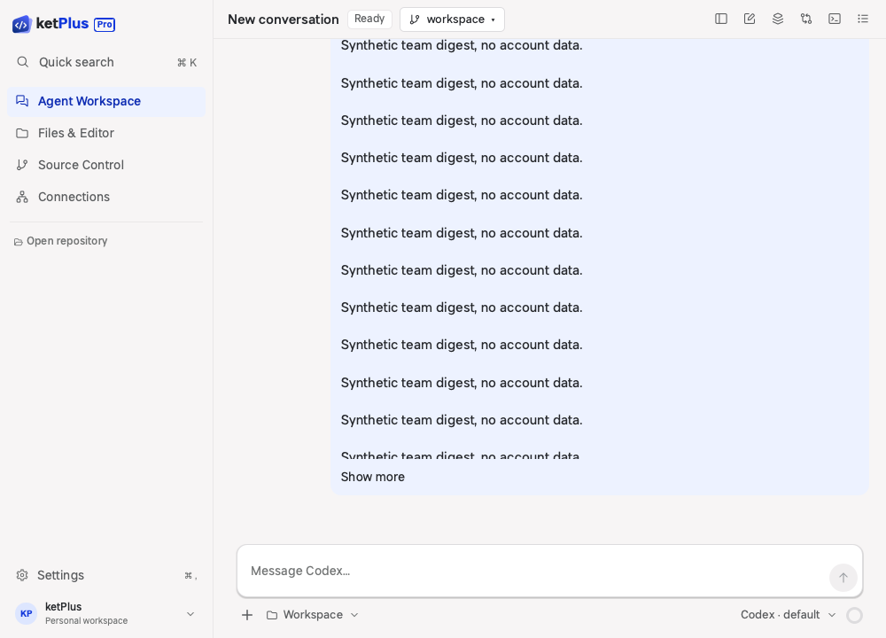
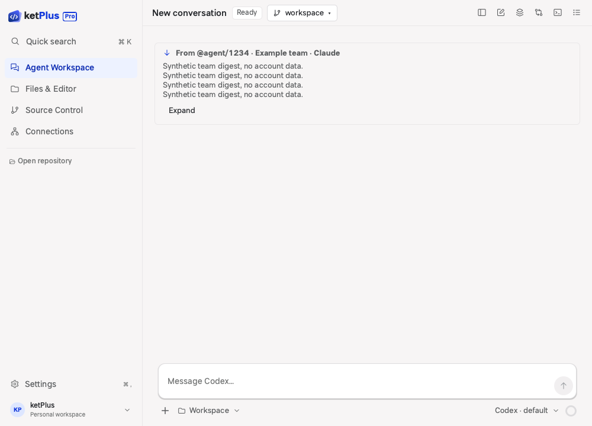
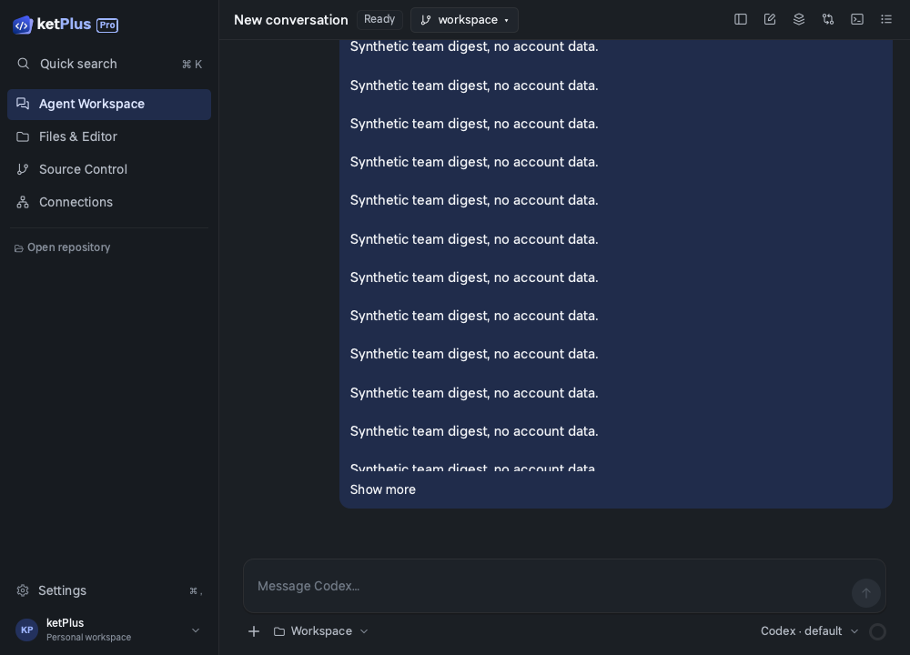
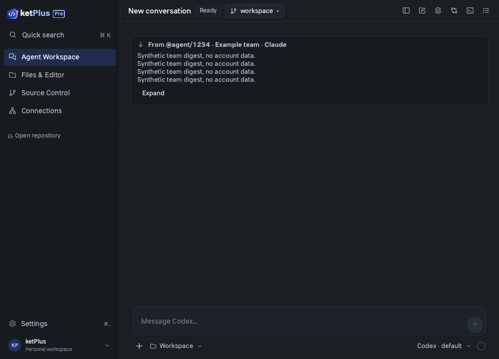

# Incoming message card comparison

Synthetic transcript fixture only; no account or conversation data. Captured offscreen
at 1000 × 720 in light and dark modes with `agentCardEvidence`.

The before captures use the baseline transcript QML with the same synthetic fixture.
The after captures show the four-line selectable preview and explicit Expand control.
Expansion, Collapse, reading-position preservation, incoming agent/system/team origins,
and the unchanged owner bubble are verified by the focused transcript tests.

| Theme | Before | After |
| --- | --- | --- |
| Light |  |  |
| Dark |  |  |
