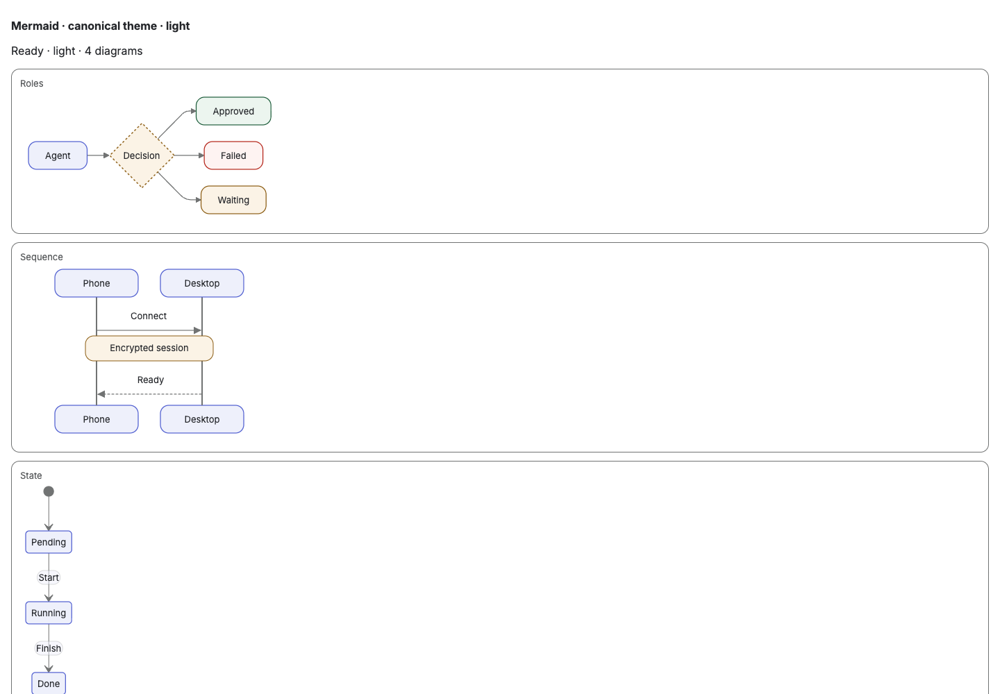
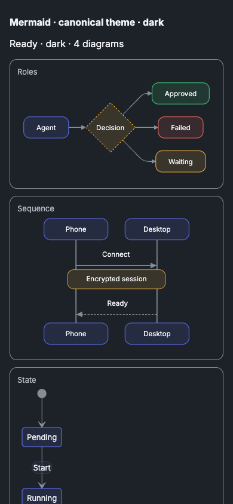

# Mermaid theme alignment

The light/dark configuration snapshots come from the public Két Design System
0.1.41 `runtime/mermaid-theme.js` and its resolved token palette at upstream
revision `4a5f82df06d5`. Full revision and source hashes live in
`resources/mermaid/SOURCE.json`; the publisher's MIT license is bundled there.
The iOS companion consumes byte-identical snapshots.

Snapshots retain the upstream configuration: Inter 13px, 12px node corners,
rounded connectors, compact flow/sequence geometry and semantic accent,
positive, warning, danger and decision classes. Qt adds explicit state-label
fills and converts SVG rectangle radii to attributes while preserving pills.
The v7 cache namespace prevents reuse of earlier themed diagrams.

## Verification

- All 16 CM test groups pass, including native Qt SVG semantic-color pixel
  checks, rounded corners and the Mermaid source/popup interaction.
- The iOS companion's 9 focused Mermaid tests pass. WebKit measures Inter
  13px, success colors, a dashed decision outline and 12px corners on light
  and dark, with natural height and syntax-error/source fallback intact.
- Chromium compared a browser-rendered reference against each consumer's
  actual bundled configuration: 1440px/light and 390px/dark, using flowchart,
  sequence, state and pie diagrams. Both consumers match geometry and computed
  styles in each theme; the two captured comparisons have zero differing pixels.
- The screenshots below are configuration comparison fixtures, not screenshots
  of the Desktop or iPhone application shell. Native rendering is covered by
  the Qt and WebKit tests above. Browser diagnostics reported no errors and
  neither viewport had horizontal page overflow.

