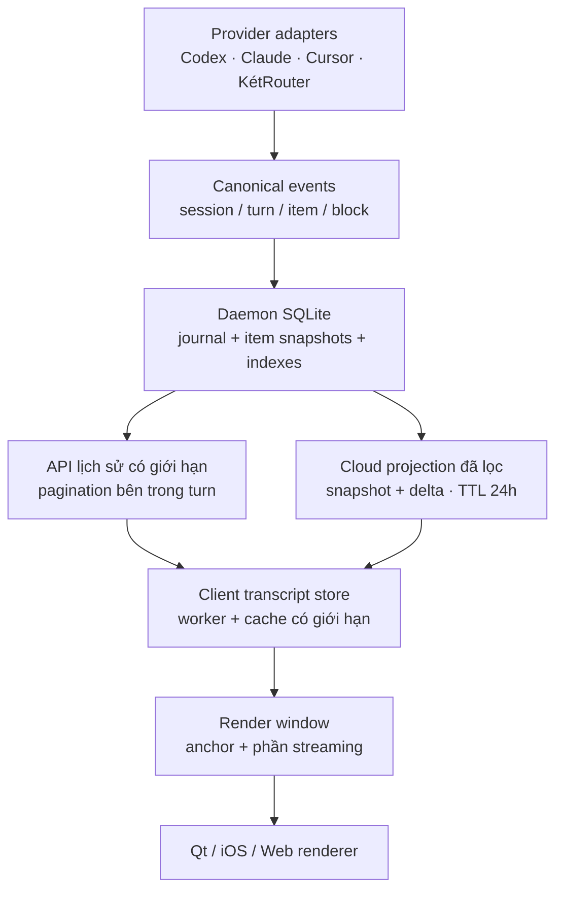

# Transcript architecture and performance review

Ngày review: 2026-09-12.

Trạng thái: **Chờ team design hoàn thành. Chưa bắt đầu implementation.**

Tài liệu này lưu kết quả review để làm đầu vào cho buổi lập kế hoạch tiếp theo.
Các phương án, thứ tự PR và performance budget bên dưới là đề xuất; chưa phải
backlog triển khai đã chốt. Sau khi có design, đối chiếu lại code mới nhất rồi
chốt task, dependency và acceptance criteria cụ thể.

## Kết luận review

Nên giữ phương án hybrid: SQLite trên daemon là nơi lưu lịch sử bền vững, cloud
giữ phần lịch sử gần nhất theo TTL, client có cache local. Cần hoàn thiện canonical
read model và giới hạn dữ liệu trước renderer trước khi mở rộng rich transcript.

Hiện tại có cả nguy cơ thiếu nội dung khi phân trang và những đường xử lý tăng
chi phí theo độ dài conversation. Chỉ tải ba turn không đủ bảo đảm nhẹ: một turn
có thể chứa hàng nghìn event hoặc nhiều MiB dữ liệu.

## Phạm vi và giới hạn bằng chứng

| Repository | Revision đã review | Nhánh chứa thay đổi tại thời điểm review |
| --- | --- | --- |
| `ketplus-desktop` — desktop và daemon | `4b14121` | `develop` |
| `ketplus-app` — iOS live client | `fdd84d4` | `develop` |
| `ketviet` — KetPlus Control API | `65f1e35f` | `integration`; chưa vào `develop` |

- Đã đọc code, tài liệu, benchmark đã có và thống kê read-only trên journal local.
- Không thay đổi implementation trong đợt review này.
- Không chạy provider, tiêu thụ quota hay profile performance mới trên iPhone.
- Các số liệu journal chỉ là thống kê tổng hợp; không lưu nội dung transcript,
  credential hoặc thông tin định danh session vào tài liệu này.
- Kết luận về mobile dựa trên đường live iOS; không coi đây là audit renderer Android.
- Với ứng dụng đóng mã nguồn, chỉ kết luận những gì tài liệu chính thức công bố.

## Quy mô dữ liệu local quan sát được

| Dữ liệu | Kết quả tại thời điểm kiểm tra |
| --- | ---: |
| Session | 14 |
| Event gốc | Khoảng 183.000 |
| Event sau compact replay | Khoảng 19.000 |
| Payload compact replay | 41,14 MiB |
| Turn lớn nhất theo payload | 6,54 MiB |
| Turn vượt giới hạn một trang hiện tại | 6 |

Các thống kê tính từ bảng `events`, `replay_events` và `sessions`; kích thước là
payload, không phải tổng dung lượng database hay RAM của ứng dụng. Journal đang
hoạt động nên số lượng sẽ thay đổi. Đây là bằng chứng về quy mô dữ liệu, không
phải phép đo latency/FPS.

## Đối chiếu các ứng dụng khác

| Ứng dụng | Cách xử lý đã xác minh | Bài học cho KetPlus |
| --- | --- | --- |
| Codex | App Server phân biệt thread, turn, item; lifecycle và delta theo item. Có turn/item pagination và lựa chọn summary/full. Chưa xác minh thuật toán virtualization của GUI từ tài liệu công khai. | Giữ identity đến cấp item; phân trang bên trong turn; tách subscribe live khỏi tải lịch sử. |
| Cursor | Công bố giảm cập nhật/fetch không cần thiết, sửa giật ở conversation dài và freeze với nhiều diff/code block. Có local search index cho hàng nghìn conversation. Chưa đủ bằng chứng về thư viện renderer nội bộ. | Cô lập cập nhật theo conversation; tải diff theo nhu cầu; search bằng index. |
| Claude Code | Fullscreen CLI chỉ giữ message đang nhìn thấy trong render tree; tool có thể thu gọn/mở rộng. Đây là renderer CLI, không phải bằng chứng về Claude Desktop. | Giới hạn render tree; tách tool detail khỏi luồng đọc chính. |
| Kilo Code | Bản hiện tại dùng Solid + `virtua`; virtualize lịch sử ổn định và tách phần assistant đang tăng. Có measurement cache, anchor theo key và prepend. | Tách lịch sử ổn định khỏi streaming; giữ anchor và cache chiều cao. Không dùng React/Virtuoso đời cũ để mô tả bản hiện tại. |
| Hermes Desktop | Giới hạn riêng dữ liệu đưa vào runtime và phần UI được dựng theo độ nặng nội dung. Giữ điểm cắt cửa sổ ổn định; gom delta theo nhịp thích ứng với chi phí xử lý. | Giới hạn dữ liệu trước renderer, không chỉ số view. Tránh dịch cửa sổ sau mỗi delta. |

Kilo và Hermes có các cơ chế sát với vấn đề KetPlus trong những source công khai
đã đọc. Không suy ra ứng dụng nào nhanh nhất khi chưa benchmark cùng workload.

Nguồn:

- [Codex App Server](https://learn.chatgpt.com/docs/app-server).
- [Cursor: performance improvements](https://cursor.com/changelog/3-1).
- [Cursor: conversation search](https://cursor.com/changelog/side-chat).
- [Claude Code: fullscreen rendering](https://code.claude.com/docs/en/fullscreen).
- [Kilo MessageList — revision c36e226](https://github.com/Kilo-Org/kilocode/blob/c36e22634860e06e0aa63234fae37bbd83d3b182/packages/kilo-vscode/webview-ui/src/components/chat/MessageList.tsx).
- [Hermes transcript window — revision 1021a03](https://github.com/NousResearch/hermes-agent/blob/1021a0325696e9070e6659f95fcd84c3e7e114df/apps/desktop/src/app/chat/transcript-window.ts).
- [Hermes streaming — revision 1021a03](https://github.com/NousResearch/hermes-agent/blob/1021a0325696e9070e6659f95fcd84c3e7e114df/apps/desktop/src/app/session/hooks/use-message-stream/index.ts).

## Nền tảng hiện có cần giữ

- 🟢 Daemon: SQLite WAL, journal, compact replay, index theo session/generation/turn/cursor.
- 🟢 Desktop: `QAbstractListModel` cập nhật từng row, QML `ListView` tái sử dụng
  delegate, reading anchor và cache tám rendered view theo soft cap.
- 🟢 iOS: `LazyVStack`, projection tăng dần, tải ba turn gần nhất, command một dòng.
- 🟢 Command output được loại khỏi payload gửi lên cloud.
- 🟢 Desktop đã có benchmark và native scroll tests.

## Gap matrix

P0: nguy cơ thiếu hoặc hiển thị sai nội dung. P1: hiệu năng và khả năng mở rộng.
P2: parity và tính năng đọc transcript.

| ID | Ưu tiên | Status | Gap | Hướng xử lý đề xuất |
| --- | --- | --- | --- | --- |
| T01 | P0 | 🔴 | iOS dùng `turnSequence` làm key của `assistantIndexes`; nhiều assistant message trong cùng turn có thể ghi đè/gộp vào nhau và sai thứ tự với tool. | Identity đến cấp session/generation/item; bảo toàn commentary, final và thứ tự. |
| T02 | P0 | 🔴 | Trang bị cắt giữa turn không có continuation tương ứng. Daemon dừng ở 500 event hoặc khoảng 768 KiB; cloud cũng có thể cắt trong turn. Client nhận snapshot cursor rồi chuyển sang turn cũ hơn, có thể bỏ qua phần chưa tải. | Pagination trong turn/item, giới hạn bytes và continuation rõ ràng; không coi snapshot bị cắt là đầy đủ. |
| T03 | P0 | 🔴 | `loadOlder()` và đường nhận live event trên iOS chưa kiểm tra lại selected session sau `await` đầy đủ như initial load. | Operation epoch và kiểm tra session/generation trước khi cập nhật state/cursor/cache. |
| T04 | P1 | 🔴 | Desktop daemon attach đọc liên tục tới cursor cuối; facade `thread/turns/list` trả mảng rỗng. Pagination của đường Codex cũ không giới hạn startup hiện tại. | Khởi tạo từ canonical page gần nhất; subscribe từ snapshot watermark; tải lịch sử theo nhu cầu. |
| T05 | P1 | 🔴 | SQLite cache iOS là `@MainActor`; mỗi persist encode, mã hóa và ghi lại blob snapshot ba turn. | Storage worker/actor riêng; incremental page/item persistence theo transaction. |
| T06 | P1 | 🔴 | Chưa giới hạn RAM của dữ liệu transcript. Desktop giữ message model; iOS giữ event/entry đã tải. `LazyVStack` không giới hạn các mảng dữ liệu. | Byte/weight budget cho active window, cache inactive và parsed content; eviction có anchor. |
| T07 | P1 | 🔴 | Streaming nối/cập nhật cả body lớn; desktop layout Markdown `TextEdit`, iOS parse `AttributedString` trong view. | Coalesce delta, block cache, chỉ parse phần đang tăng; lazy highlight/media/Mermaid. |
| T08 | P1 | 🔴 | Cloud đọc toàn bộ event của session rồi `filter/sort/slice` trong JavaScript. TTL job quét toàn bảng, row redacted vẫn còn. | Query keyset có index và limit ngay tại DB; maintenance theo batch, có chính sách retention metadata. |
| T09 | P1 | 🟡 | Mobile lấy session list và một page 100 event mỗi vòng rồi nghỉ một giây; backlog lớn bắt kịp chậm. Output delta mất output nhưng vẫn có envelope metadata trên cloud. | Drain backlog có giới hạn, giảm polling không cần thiết; projection stream và watermark phù hợp để bỏ event không dùng. |
| T10 | P2 | 🔴 | Live mobile chỉ parse Markdown inline, chưa ngang desktop về table/code block/Mermaid/media/file diff. | Shared semantic contract; renderer native theo block và tải phần nặng khi cần. |

### Vị trí code làm bằng chứng

Đường dẫn bên dưới tương đối với repository được ghi tên, tại revision trong
bảng phạm vi. Line number là mốc của lần review này và có thể thay đổi sau đó.

| Gap | Repository | File / vị trí |
| --- | --- | --- |
| T01 | `ketplus-app` | `apps/ios/Sources/KetPlusRemoteFeature/LiveTranscriptView.swift`, `assistantIndexes`, dòng 96–153 |
| T02 | `ketplus-desktop` | `apps/daemon/src/storage/LocalJournal.cpp`, `transcriptPage`, dòng 586–676 |
| T02 | `ketviet` | `apps/ketsuite/modules/ketplus_control/src/relay-functions.ts`, `readTranscriptPage`, dòng 1621–1648 |
| T02 | `ketplus-app` | `apps/ios/Sources/KetPlusRemoteFeature/LiveRemoteView.swift`, `loadInitialTranscript`; client truyền tiếp `truncated` nhưng store chưa xử lý continuation |
| T03 | `ketplus-app` | `apps/ios/Sources/KetPlusRemoteFeature/LiveRemoteView.swift`, `loadOlder`, dòng 152; `refresh`, dòng 204 |
| T04 | `ketplus-desktop` | `modules/ai/src/agent/CodexAppServer.cpp`, facade dòng 422; `attachDaemonSession`, dòng 611 |
| T05 | `ketplus-app` | `apps/ios/Sources/KetPlusRemoteCore/SQLiteTranscriptStore.swift`, `@MainActor`, `saveTranscript`, dòng 144 |
| T06 | `ketplus-desktop` | `docs/chat-pagination.md`; `modules/ai/src/agent/AgentWorkspaceRenderCache.cpp` |
| T06 | `ketplus-app` | `apps/ios/Sources/KetPlusRemoteFeature/LiveRemoteView.swift`, `merge`, dòng 287 |
| T07 | `ketplus-desktop` | `modules/ai/src/agent/AgentSessionState.cpp`, `appendAgentDelta`; `modules/ai/src/agent/qml/AgentWorkspace.qml`, dòng 1216 |
| T07/T10 | `ketplus-app` | `apps/ios/Sources/KetPlusRemoteFeature/LiveTranscriptView.swift`, Markdown initializer, dòng 405 |
| T08 | `ketviet` | `apps/ketsuite/modules/ketplus_control/src/relay-functions.ts`, dòng 1522 và 1592; `src/jobs.ts`, dòng 30 |
| T09 | `ketplus-app` | `apps/ios/Sources/KetPlusRemoteFeature/LiveRemoteView.swift`, `run`, dòng 59; `HTTPControlPlaneClient.swift`, event page limit |
| T09 | `ketplus-desktop` | `apps/daemon/src/cloud/CloudEventProjection.cpp`, dòng 15; `CloudControlClient.cpp`, `uploadSessionEvents` |

## Kiến trúc đích đề xuất

### 1. Canonical đến cấp item/block

Envelope có version chưa đủ: payload và renderer hiện vẫn biết các kiểu Codex
như `agentMessage`, `commandExecution`. Adapter cần chuyển chúng thành schema
chung cho message, tool, reasoning-summary được provider cung cấp, approval/question,
compaction và attachment. Cần stable ID, revision, trạng thái và quan hệ cha/con.
UI không tự diễn giải raw provider event.

### 2. Tách đồng bộ live khỏi phân trang lịch sử

Sync cursor xác định đã nhận event đến đâu. History cursor xác định đang đọc
phần nào của lịch sử. Turn lớn cần continuation bên trong turn/item. Snapshot
chỉ đầy đủ theo phạm vi nó thực sự bao phủ; phải phân biệt phần chưa tải với
phần không tồn tại hoặc đã hết retention.

### 3. Giới hạn nhiều tầng

Có budget cho response, dữ liệu đã decode, Markdown đã parse, media và view đang
dựng. Giữ ba turn là phạm vi mở đầu, nhưng item/block bên trong được tải theo
viewport và byte budget. Eviction khỏi RAM không xóa lịch sử bền vững. Giữ anchor,
selection và active turn khi thay đổi cửa sổ.

### 4. Streaming cập nhật phần thay đổi

Gom delta theo item; thử nhịp 33–50 ms, flush ngay khi hoàn tất hoặc gặp sự kiện
cần giữ thứ tự. Block hoàn tất giữ nguyên; highlight, Mermaid và media tải khi
cần. Encode/decode, crypto, SQLite và projection nặng chạy ngoài UI thread.
Không chia Markdown theo số ký tự tùy ý: phải xử lý fence, reference và block
chưa hoàn tất, đồng thời giữ selection/copy/link đúng.

### 5. Cache/sync độc lập với render

iOS lưu page/item thay đổi theo transaction, tránh ghi lại cả snapshot lớn.
Cloud nhận projection đã được daemon chuẩn hóa và lọc trước khi mã hóa. Muốn
bỏ hẳn envelope output rỗng cần contract cursor hoặc watermark mới; không bỏ
event tùy tiện trong protocol hiện yêu cầu cursor liên tục.

## Các tính năng cần đối chiếu với design

- Markdown block đầy đủ: paragraph, heading, list, table, code block và links.
- File-change/diff card: summary trong timeline, nội dung nặng tải khi mở.
- Media/Mermaid lazy, trạng thái đang tải/lỗi, zoom và giới hạn tài nguyên.
- Question/approval, tool lifecycle, compaction và interruption thống nhất.
- Search bằng index; copy/export lấy unloaded history theo nhu cầu.
- Reading anchor, prepend, jump-to-latest và trạng thái có nội dung mới.
- Loading, retry, offline, cloud hết retention và lịch sử cần daemon.
- Giữ yêu cầu đã chốt: command một dòng, trạng thái Run/Ran, chỉ gửi lệnh,
  không gửi output lên cloud; xem command output/detail là slice để sau.

## Thứ tự triển khai sơ bộ — chưa chốt task

1. Correctness: item identity, continuation trong turn lớn, stale response và
   snapshot/live reconciliation.
2. Storage/API: desktop mở từ trang gần nhất, iOS storage worker và incremental
   persistence, cloud query keyset có byte limit.
3. Performance: RAM budget, render window, delta batching, Markdown block cache.
4. Parity: rich transcript mobile, search/export và các tương tác theo design.

Không bắt đầu các PR này trước khi hoàn tất bước lập kế hoạch sau design.

## Performance validation cần đưa vào kế hoạch

Benchmark desktop đã có ngày 2026-09-11 ghi nhận khoảng 62 FPS với fixture sáu
conversation × 200 message trên M1 Pro, Release, Qt/Metal. Đây là checkpoint cũ,
không đại diện cho turn nhiều MiB hoặc iPhone:
[benchmark đọc/scroll](../benchmarks/results/2026-09-11-chat-reading-anchor-macos-m1-pro.md).

Fixture cần bao phủ:

- 1.000 và 10.000 message; một message khoảng 1 MiB.
- Một turn chứa hàng nghìn tool event và vượt giới hạn một response.
- Streaming đồng thời với kéo lên, prepend, đổi width/font và jump-to-latest.
- Chuyển qua 20 conversation nhiều vòng để kiểm tra cache thrash và memory plateau.
- Page/live overlap, duplicate, stale response, reconnect, TTL gap và partial snapshot.
- Table/code/Mermaid/media dài; không dùng provider thật để tạo fixture.

Metric cần đo: first-content latency, frame time, UI stall, RAM sau eviction,
chi phí projection/parse/persist, CPU idle và lượng request/bytes mạng.

Mục tiêu khởi đầu để benchmark, chưa phải kết quả đạt được:

| Metric | Mục tiêu đề xuất |
| --- | --- |
| Warm conversation switch | p95 dưới 100 ms |
| Nội dung đầu tiên từ local storage | p95 dưới 500 ms |
| RAM sau nhiều vòng chuyển conversation | Đạt mức ổn định sau eviction |
| Correctness khi paging/streaming | Không mất/trùng item; giữ thứ tự và reading anchor |

Chốt frame-time, memory và network budget cụ thể sau khi có fixture/design và
baseline trên thiết bị đích. iOS cần profile trên thiết bị thật, không dùng
Simulator làm bằng chứng performance cuối cùng:
[Apple: performant scrollable stacks](https://developer.apple.com/documentation/swiftui/creating-performant-scrollable-stacks),
[Apple: app responsiveness](https://developer.apple.com/documentation/xcode/improving-app-responsiveness).

## Điểm tiếp tục sau khi team design hoàn thành

1. Nhận design/spec và xác định màn hình, interaction, lifecycle cần hỗ trợ.
2. Refresh revision của ba repo và kiểm tra lại các finding chưa được xử lý.
3. Map design vào canonical schema, paging, cache và renderer; ghi rõ dependency.
4. Chia task/PR có scope, owner repo, acceptance criteria, test fixture và
   performance budget. Xác nhận thứ tự thực hiện cùng người dùng.

Đang chờ design; chưa giao task implementation hoặc bắt đầu build/deploy.
